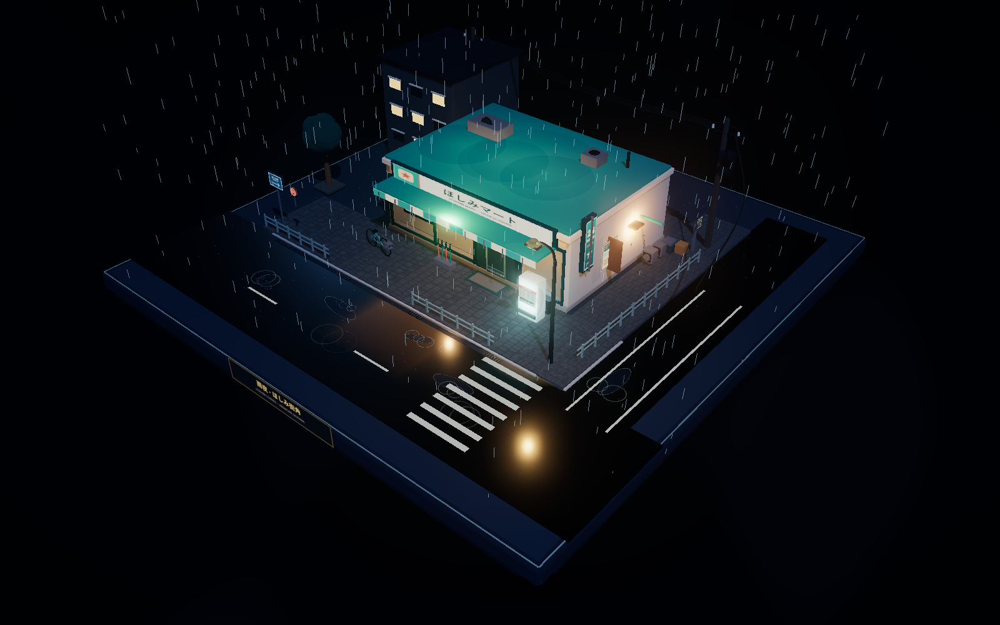

# 雨夜便利店 · 微缩街角

一座可以自由旋转、缩放观看的日式便利店雨夜街角三维微缩景观。使用 Three.js 实时渲染，以三渲二材质、程序化建模、动态雨效和霓虹 Bloom 营造浓厚的日式动画氛围。

**[在线体验](https://3-dd-del.github.io/yeren-garden/)** · **[GitHub 仓库](https://github.com/3-dd-del/yeren-garden)**



## About

这是一个完整搭建在正方形收藏模型底座上的便利店街角小场景。便利店位于视觉中心，周围紧凑布置了日本社区街角常见的店铺、道路与生活设施。页面没有 UI 覆盖层，打开后即可直接观察和操控整座微缩模型。

场景主体由 Three.js 程序化搭建，不依赖外部三维模型。材质采用干净的卡通分层表现，配合雨夜霓虹、积水倒影、动态雨线、雾气和 Bloom（泛光）后处理，形成小巧、精致、可收藏的模型感。

## 场景内容

- **收藏模型底座**：正方形完整底座、金属包边、隐藏式软阴影与模型铭牌。
- **便利店主体**：发光招牌、侧面 `24H` 灯箱、玻璃橱窗、自动门、屋檐雨棚、门口地垫和入口贴纸。
- **店内陈设**：冷藏饮料墙、货架商品、收银台、热食柜、时钟、海报与暖色室内灯光。
- **街角环境**：反光斑马线、停车位、排水沟、湿润积水路面、街角护栏与小巷入口。
- **街道设施**：自动贩卖机、自行车、雨伞架、分类垃圾桶、路灯、电线杆、下垂电线、路牌和公告海报栏。
- **建筑细节**：空调外机、屋顶设备、店铺侧墙与巷道层次。
- **雨夜氛围**：560 条动态雨线、积水涟漪、湿地反光、霓虹 Bloom、雾效与冷月光。

## 交互方式

| 操作 | 桌面端 | 触屏端 |
| --- | --- | --- |
| 旋转视角 | 按住鼠标左键拖拽 | 单指拖动 |
| 缩放视角 | 鼠标滚轮 | 双指缩放 |
| 平移视角 | 按住鼠标右键拖拽 | 双指拖动 |
| 重置到初始构图 | 刷新页面 | 刷新页面 |

场景支持 `OrbitControls`，可在完整底座范围内自由观察。画面不包含按钮、标题栏、说明面板或其他界面元素。

## 技术栈

- **Three.js**：WebGL 场景、相机、光照与实时渲染。
- **MeshToonMaterial**：三渲二卡通材质与分层明暗。
- **CanvasTexture**：程序化生成招牌、路面、贴纸与装饰纹理。
- **UnrealBloomPass**：霓虹招牌和环境高光泛光。
- **OrbitControls**：旋转、缩放与平移交互。
- **esbuild**：前端资源构建与打包。
- **GitHub Actions + GitHub Pages**：自动构建、校验和在线部署。

## 本地运行

需要 Node.js 22 或兼容版本。

```bash
npm ci
npm run build
npm start
```

浏览器打开：<http://127.0.0.1:4173/>

Windows 也可以双击 `启动雨夜便利店预览.cmd`。

## 构建与验证

```bash
npm run build
npm run verify
npm run check:browser
```

- `npm run build`：将源码打包到 `dist/`。
- `npm run verify`：检查页面无 UI 覆盖层、Three.js 入口、交互控制器和场景要素。
- `npm run check:browser`：通过 Chromium DevTools Protocol 实际执行拖拽和滚轮缩放，验证相机状态变化及截图输出。

浏览器交互检查需要本地服务运行在 `http://127.0.0.1:4174/`，并启动监听 `9223` 端口的远程调试 Chromium。

## 自动部署

仓库包含 `.github/workflows/pages.yml`。推送代码到 `main` 分支后，GitHub Actions 会依次执行：

1. 安装依赖。
2. 构建静态资源。
3. 运行静态校验。
4. 上传 `dist/` 构建产物。
5. 部署到 GitHub Pages。

在线站点：**<https://3-dd-del.github.io/yeren-garden/>**

## 项目结构

```text
.
├─ src/
│  ├─ index.html          无 UI 的全屏场景入口
│  ├─ main.js             场景启动入口
│  ├─ night-scene.js      场景建模、材质、灯光、雨效与交互
│  └─ styles.css          全屏画布样式
├─ scripts/
│  ├─ build.mjs           esbuild 构建脚本
│  ├─ serve.mjs           本地静态服务器
│  ├─ verify.mjs          静态结构与要素校验
│  └─ browser-check.mjs   浏览器交互验证
├─ docs/images/           README 预览图
├─ .github/workflows/     GitHub Pages 自动部署
└─ package.json
```

## 设计重点

- 以正方形微缩底座建立清晰的收藏模型边界。
- 使用紧凑构图同时呈现便利店正面、街角道路与侧巷空间。
- 通过冷色雨夜环境与便利店暖色室内光形成色彩对比。
- 以轮廓明确、材质干净的卡通渲染强化日式动画氛围。
- 保持纯画布体验，不添加任何会遮挡模型的 UI 界面。