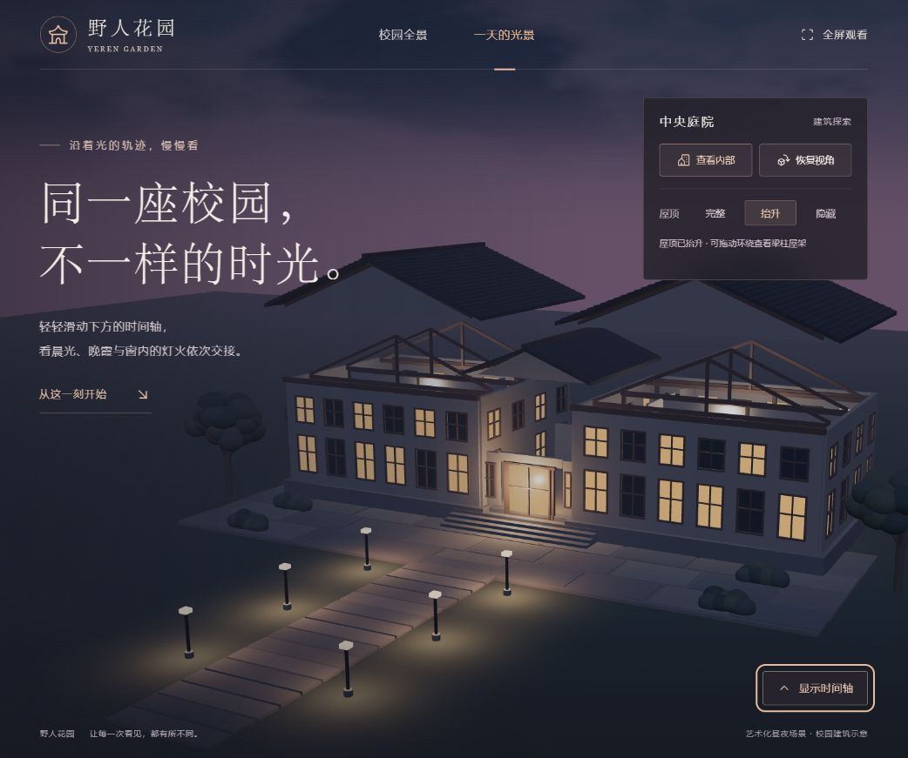
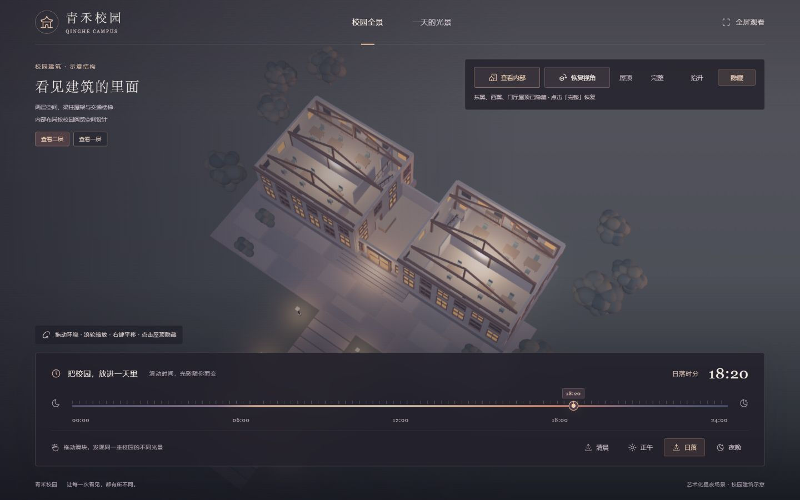
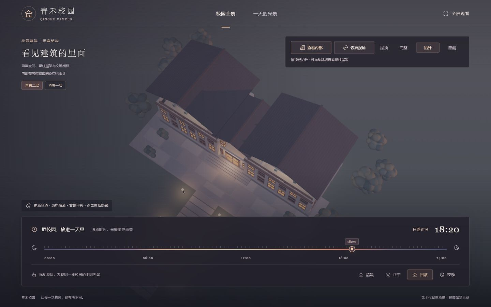

# 野人花园 (yeren-garden)

一个面向普通大众的三维校园展示网站：**拖动视角看建筑，拨动时间看光影，掀开屋顶看内部。** 使用 Blender 建模、Three.js 实时渲染，让同一座庭院呈现从清晨到深夜的不同模样。

**在线访问：[https://3-dd-del.github.io/yeren-garden/](https://3-dd-del.github.io/yeren-garden/)**



## 现在能做什么

- 24 小时时间轴：从 `00:00` 到 `23:59`，也可以直接切换清晨、正午、日落和夜晚；天空、光照、阴影与窗光随时间变化。
- 环绕观察：鼠标拖动查看建筑各个方向，滚轮缩放，右键平移。
- 点击屋顶看内部：东翼、西翼、中央门厅的屋顶独立控制，也支持一键隐藏、抬升和恢复。
- 查看两层内部：包含阅览空间、桌椅、书架、走廊、隔墙、木梁柱、屋架、U 形楼梯、楼梯洞口与栏杆；可以切换一层和二层。
- 首页导航带滑动切换效果，支持全屏观看和恢复默认视角。
- 时间浮窗可以隐藏、恢复，保留当前时间、屋顶和楼层状态。
- 时间轴和导航支持键盘操作，尊重系统的减少动态效果偏好。
- 网站为纯前端静态页面，可部署到 GitHub Pages 等静态托管服务。

## 怎么操作

| 操作 | 效果 |
| --- | --- |
| 在场景空白处按住鼠标左键拖动 | 环绕建筑旋转 |
| 滚轮 / 按住右键拖动 | 缩放 / 平移 |
| 点击可见屋顶 | 隐藏对应屋顶，转入内部观察视角 |
| 查看内部 | 一次隐藏所有屋顶 |
| 屋顶「完整 / 抬升 / 隐藏」 | 还原屋顶、抬升 4.5 个模型单位或移除覆盖层 |
| 查看一层 / 查看二层 | 移开或恢复二层楼板和室内构件 |
| 恢复视角 | 回到初始观察方向，保留屋顶和楼层选择 |
| 隐藏浮窗 / 显示时间轴 | 收起或恢复底部时间面板 |
| 拖动时间轴 / 点击时段预设 | 改变一天中的时间 |

时间轴支持方向键、Home 和 End；导航页签支持左右键、Home 和 End。在时间浮窗内按 Escape 可收起浮窗。

<details>
<summary>查看室内与屋顶抬升截图</summary>





</details>

## 本地运行

需要 **Node.js 22 或更高版本**。下载或克隆项目后执行：

```bash
git clone https://github.com/3-dd-del/yeren-garden.git
cd yeren-garden
npm ci
npm run build
npm start
```

浏览器访问 **http://127.0.0.1:4173/**。

Windows 用户完成首次安装和构建后，也可以双击 `启动校园预览.cmd` 启动。修改源码后需重新执行 `npm run build`，再刷新页面。

```bash
npm start -- --port 4174  # 使用其他端口
```

## 验证与构建

```bash
npm run build   # 打包 HTML、CSS、JavaScript、模型和图标，输出到 dist/
npm run verify  # 校验模型结构、构件分组、文件模式数据及 1441 个时间采样状态
```

`verify` 检查 GLB 格式、三组独立屋顶、二层构件标记、屋架、楼梯踏步及楼梯洞口周围楼板，并确认文件模式模型数据与 GLB 一致。它是静态数据检查，不能代替浏览器交互测试。

项目开发时已在本地 HTTP 预览中检查视角拖动、屋顶操作、楼层切换、时间预设、浮窗隐藏与恢复，以及多个电脑端窗口尺寸。直接双击 `dist/index.html` 的文件模式提供了兼容加载路径，但未完成浏览器实测，建议使用本地服务或在线站点。

## 模型编辑

仓库包含可编辑的 Blender 源文件和可重复执行的建模脚本，日常构建网站不需要安装 Blender。

- `assets/qinghe-campus.blend`：Blender 模型源文件。
- `assets/campus.glb`：网页使用的模型，包含建筑、屋顶和楼层分组标记。
- `scripts/build-campus.py`：程序化建模与导出脚本。

重新生成模型需要 Blender。`package.json` 中的命令默认使用 Windows 下的 Blender 5.2 路径，请按本机安装位置调整后执行：

```bash
npm run model
npm run build
npm run verify
```

也可以直接调用自己的 Blender：

```bash
blender --background --python scripts/build-campus.py
```

## 在线部署

仓库通过 **GitHub Actions + GitHub Pages** 自动发布：推送到 `main` 后，安装依赖、构建、运行静态校验，再部署 `dist/`。

工作流文件：`.github/workflows/pages.yml`。复用到自己的仓库时，在 **Settings → Pages → Build and deployment → Source** 中选择 **GitHub Actions**。

构建结果使用相对资源路径，可以部署在域名根目录或项目子目录。`dist/` 是生成内容，不直接提交到 Git。

## 项目结构

```text
src/
  index.html              页面结构与控件
  styles.css              桌面布局与视觉样式
  main.js                 导航、时间轴、浮窗、全屏与加载逻辑
  scene.js                Three.js 场景、相机、点击检测、屋顶与楼层控制
  time.js                 昼夜配色与照明插值
assets/                   GLB 模型、Blender 源文件和网站图标
scripts/
  build-campus.py         Blender 建模与 GLB 导出
  build.mjs               网站打包
  serve.mjs               本地静态预览服务
  verify.mjs              静态数据校验
docs/images/              实际页面截图
.github/workflows/        GitHub Pages 自动部署
```

技术栈：**Blender · Three.js · JavaScript · CSS · esbuild · Tabler Icons**。

## 项目范围

目前提供电脑端首页，暂未制作详情页、手机和平板适配、第一人称步行漫游。

建筑和内部空间是原创示意设计，并非某所学校的实测建筑图纸；日照采用艺术化昼夜循环，不用于真实地理位置的太阳轨迹或建筑采光计算。历史模型文件名保留 `qinghe-campus`，页面品牌为「野人花园」。
